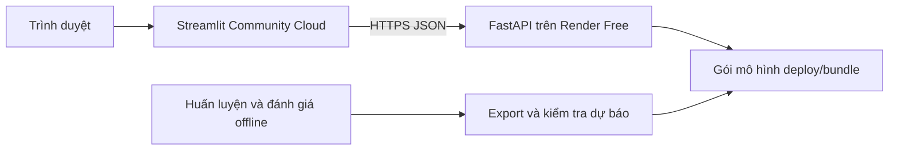

# FastAPI backend + Streamlit frontend

Kiến trúc theo hướng giảng viên và [bài tham khảo Pybites](https://pybit.es/articles/my-experience-building-a-fastapi-streamlit-app/): hai service triển khai độc lập, trao đổi JSON qua HTTP. Hướng mặc định: **Render Free** cho FastAPI; **Streamlit Community Cloud** cho frontend. Các phần hướng dẫn Deta trong bài năm 2023 không được dùng làm cấu hình hiện tại.



Streamlit không đọc mô hình, parquet hay CSV local để suy luận. FastAPI đọc một gói đã kiểm tra checksum, nạp mô hình một lần khi khởi động và không cung cấp endpoint huấn luyện. CORS không cần cho kiến trúc này: request do server Streamlit gửi, không phải JavaScript trong trình duyệt.

## 1. Chạy local

Cài đầy đủ môi trường theo README; tại thư mục dự án:

```powershell
.\.venv\Scripts\python.exe scripts/export_serving_bundle.py
.\.venv\Scripts\python.exe scripts/run_local.py
```

Hoặc chạy `start_demo.bat` / `start_demo.ps1`. Mở frontend `http://127.0.0.1:8501`, Swagger `http://127.0.0.1:8000/docs`, health `http://127.0.0.1:8000/health`. Launcher chỉ dừng hai tiến trình con mà nó tạo khi nhấn Ctrl+C. Nếu cổng bận, dùng `--api-port 8001 --frontend-port 8502` hoặc dừng phiên demo cũ.

Chạy tách terminal:

```powershell
# Terminal 1
.\.venv\Scripts\python.exe -m uvicorn backend.main:app --host 127.0.0.1 --port 8000

# Terminal 2
$env:API_BASE_URL = 'http://127.0.0.1:8000'
.\.venv\Scripts\python.exe -m streamlit run frontend/app.py
```

## 2. Nội dung gói triển khai

`scripts/export_serving_bundle.py` lấy các mô hình đã huấn luyện trong `artifacts/models/`, dữ liệu UCI theo giờ và kết quả kiểm định để tạo **`deploy/bundle/`**, được đưa vào Git. Gói này không chứa file UCI theo phút 133 MB hoặc `.venv`.

`manifest.json` có checksum từng file, thứ tự đặc trưng, schema và `model_version` theo nội dung. Export đối chiếu toàn bộ 7 mô hình với 4.900 dự báo test; startup backend từ chối file thiếu/sai checksum. Các pipeline `.joblib` chứa cả imputer/scaler đã fit. Chỉ nạp model do chính dự án xuất, không chấp nhận upload pickle tùy ý. Giữ phiên bản sklearn/XGBoost giống `backend/requirements.txt` khi tạo model mới.

Quyền dữ liệu: UCI-235, Georges Hébrail và Alice Bérard, [DOI 10.24432/C58885](https://doi.org/10.24432/C58885), CC BY 4.0. Đây là dữ liệu công khai của một hộ gia đình tại Pháp. Chưa có dữ liệu Việt Nam trong bản này.

## 3. Deploy backend trên Render Free

Repository của dự án: [DPEldich/household-power-forecast](https://github.com/DPEldich/household-power-forecast), private, branch `main`. [Mở cấu hình Deploy to Render](https://render.com/deploy?repo=https%3A%2F%2Fgithub.com%2FDPEldich%2Fhousehold-power-forecast). Đây là đường dẫn thiết lập, không phải URL của backend đã chạy. Với repo private, tài khoản Render cần được cấp quyền trên đúng repository này.

1. Đưa source và `deploy/bundle/` lên GitHub; không đưa `.streamlit/secrets.toml`, khóa API hoặc `.env` vào Git.
2. Trên Render, chọn **New → Blueprint**, kết nối repository/branch và dùng `render.yaml`. Blueprint khai báo đúng **plan: free**, chỉ một backend. Không bật dịch vụ trả phí hoặc persistent disk.
3. Hoặc tạo Web Service thủ công với repository root là thư mục gốc, Python 3.13, build `pip install -r backend/requirements.txt`, start `python -m uvicorn backend.main:app --host 0.0.0.0 --port $PORT --workers 1`, health check `/health`. Không chạy `run_pipeline.py` trong build/start.
4. Nếu muốn giới hạn người gọi API, đặt `HOUSEHOLD_POWER_API_KEY` trong Render Environment và cùng giá trị `API_KEY` trong Streamlit Secrets. Không đặt khóa ở query string hay JavaScript. Để trống thì các endpoint đọc/dự báo dùng dữ liệu UCI công khai là public.
5. Chờ deploy đạt trạng thái live, mở `https://<service>.onrender.com/health` kiểm tra `status=ok`, `models=7` và `model_version`. Swagger ở `/docs`. Sao chép URL này cho frontend.

Render cần quyền truy cập repository của tài khoản bạn. Phiên GitHub trên máy không tự đăng nhập Render. Nếu Render yêu cầu OAuth/quyền repository hoặc chấp nhận điều khoản lần đầu, chủ tài khoản cần hoàn tất bước đó.

## 4. Deploy frontend trên Streamlit Community Cloud

1. Đăng nhập Streamlit Community Cloud và cho phép truy cập repository đã chọn.
2. Tạo app, chọn cùng repository/branch, **main file path: `frontend/app.py`**, chọn **Python 3.13**.
3. Community Cloud đọc `frontend/requirements.txt` cạnh entrypoint. Frontend chỉ cần Streamlit, pandas/numpy, Plotly và requests; không cần cài model libraries.
4. Trong **Advanced settings → Secrets**, đặt:

```toml
API_BASE_URL = "https://<service>.onrender.com"
API_KEY = ""
```

Điền `API_KEY` nếu backend đã cấu hình khóa. URL và khóa cũng có thể cấu hình bằng biến môi trường khi host frontend ở nơi khác. Mẫu local tại `.streamlit/secrets.toml.example`.

5. Deploy, mở tab dự báo, chọn Persistence rồi XGBoost, bấm **Thực thi suy luận trực tiếp**. Cả hai phải hiện xác minh thành công; sidebar hiển thị đúng phiên bản backend.

## 5. Giới hạn gói miễn phí

Theo [Render Free docs](https://render.com/docs/free), backend ngủ sau 15 phút không có request và khởi động lại có thể mất khoảng một phút. UI có spinner/thông báo lỗi và nút làm mới; request timeout đọc là 90 giây. Các giới hạn free có thể thay đổi, kiểm tra dashboard khi deploy. Không dùng cron ping để giữ server thức.

Filesystem Render Free không bền vững khi restart/redeploy. Vì vậy model đi kèm source release, không được train/upload rồi kỳ vọng lưu vĩnh viễn trên server. Không cần database cho demo read-only này. Streamlit Community Cloud cũng có cơ chế ngủ và giới hạn tài nguyên của dịch vụ; mở cả backend và frontend trước buổi bảo vệ.

## 6. Nâng cấp mô hình và rollback

1. Huấn luyện, tinh chỉnh và đánh giá offline; không dùng test để tinh chỉnh.
2. Chạy `scripts/generate_reports.py`, `scripts/export_serving_bundle.py`, rồi `python -m pytest -q`.
3. Commit source, báo cáo và toàn bộ bundle cùng một phiên bản; push branch triển khai. Theo dõi Render rebuild/restart và `/health` của bản mới.
4. Nếu chỉ đổi trọng số/metric mà schema giữ nguyên, frontend không cần đổi code. Bấm **Làm mới dữ liệu API** để lấy snapshot mới. Request dự báo mang `expected_model_version`; backend trả **409** nếu frontend còn giữ bản cũ.
5. Khi đổi API/đặc trưng/đơn vị, cập nhật backend và frontend cùng hợp đồng, kiểm thử ở branch riêng trước. Dữ liệu UCI và Việt Nam nên có release/model riêng.
6. Rollback backend bằng release/commit đã biết tốt. Nếu đổi frontend, rollback frontend cùng bản tương thích. Rollback một bên không tự rollback bên còn lại. Với native hosting, pin dependency/model format trước khi restore.

Gói model hiện lưu trong Git đủ nhỏ cho đồ án; khi số lượng/model tăng nhiều, chuyển sang artifact storage có version và checksum thay vì tăng repository vô hạn.

## 7. API contract

| Endpoint | Chức năng |
|---|---|
| `GET /health` | Readiness và phiên bản, không cần API key |
| `GET /v1/dashboard` | Metadata, metric, dự báo test chung một snapshot |
| `GET /v1/history?target_timestamp=...&hours=24` | Lịch sử trước mục tiêu, giữ nguyên giờ thiếu |
| `POST /v1/predict` | Suy luận bằng mô hình đã lưu, kiểm tra phiên bản |

Các endpoint `/v1/*` nhận header `X-API-Key` nếu đã bật khóa. Body replay:

```json
{
  "model": "XGBoost",
  "target_timestamp": "2010-05-01T12:00:00",
  "expected_model_version": "<model_version từ dashboard>"
}
```

Có thể bổ sung `history` gồm 168–336 quan sát `{timestamp, active_power_kw}` để dự báo một giờ mới; dùng timestamp giờ liên tục, kết thúc đúng một giờ trước mục tiêu, `null` cho giờ thiếu. Mô hình hiện dùng giờ địa phương không gắn timezone theo dữ liệu UCI; API từ chối timestamp timezone-aware để tránh đổi múi giờ ngầm. Đầu vào là **công suất trung bình giờ kW**, không phải chỉ số công tơ kWh tích lũy. Không coi dự báo từ dữ liệu tự cung cấp là đã được kiểm chứng tại Việt Nam.

## 8. Kiểm thử và nguồn tham khảo

```powershell
.\.venv\Scripts\python.exe -m pytest -q
.\.venv\Scripts\python.exe -m pip check
```

Test frontend khởi động backend thật ở cổng tạm, gọi HTTP, thao tác live prediction và kiểm tra frontend không import model libraries. Test API gồm parity của 7 mô hình, auth, version mismatch, input tương lai/sai giờ, gói model lỗi và timeout/cold-start response. Các test ML/báo cáo cũ tiếp tục dùng kết quả thực nghiệm đã chốt.

- [Pybites: tách FastAPI và Streamlit](https://pybit.es/articles/my-experience-building-a-fastapi-streamlit-app/)
- [Render: FastAPI](https://render.com/docs/deploy-fastapi)
- [Render: giới hạn Free](https://render.com/docs/free)
- [Streamlit: entrypoint và dependencies riêng](https://docs.streamlit.io/deploy/streamlit-community-cloud/deploy-your-app/file-organization)
